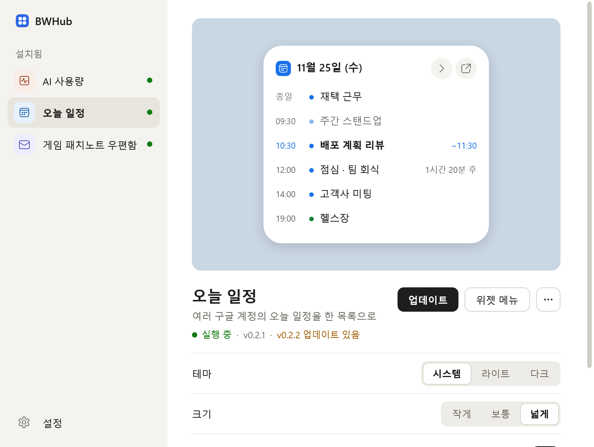
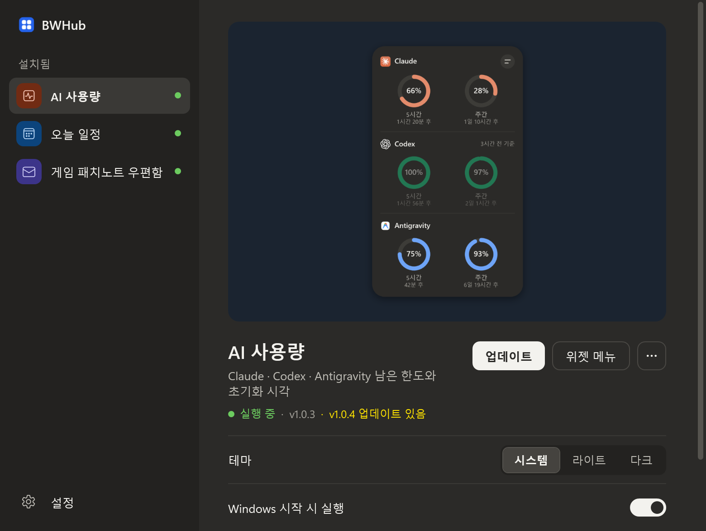
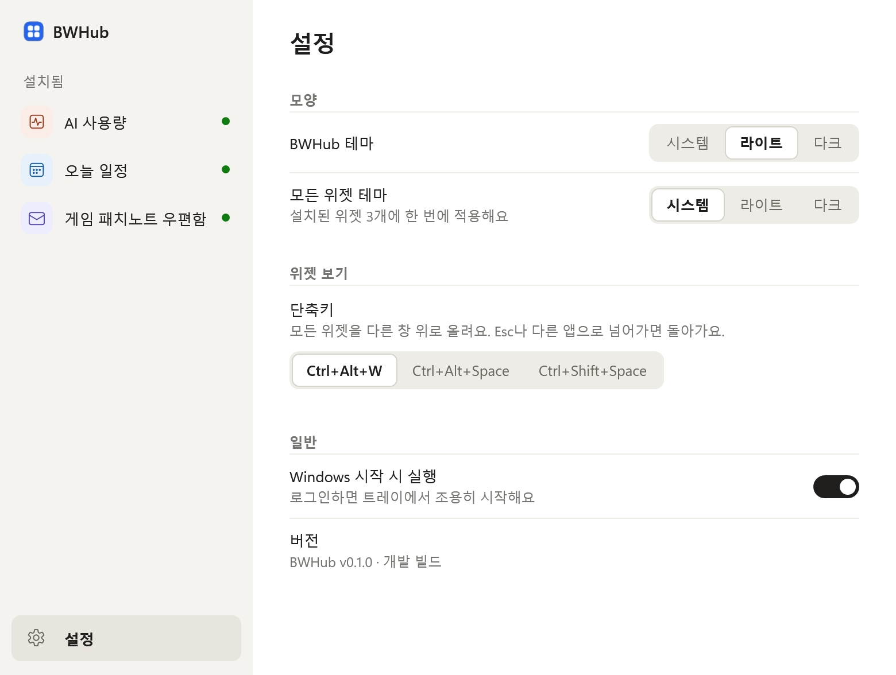

# BWHub

A hub for [BWUI](https://github.com/byeonggwan/bwui) desktop widgets: install and update them, change their settings in one place, and bring them all above your other windows with one hotkey.

| Widget | Dark |
|---|---|
|  |  |

| Settings |
|---|
|  |

## Window

Click the tray icon (or start `BwHub.exe` again) to open it. Closing the window keeps BWHub in the tray.

- **Sidebar** — installed widgets (a dot shows which are running), then the ones you can still get, then **Settings**.
- **A widget** — its preview (the snapshot from its repository, light or dark), state and versions, and its actions:
  - **Install** / **Update** download the latest GitHub release, check each file's SHA-256, and start the widget.
  - **Widget menu** brings the widgets up and opens that widget's own right-click menu, for things only it has (accounts, sections).
  - **⋯** has Restart, Exit, Reinstall and View on GitHub.
  - Theme, size (when the widget has more than one), Start with Windows and Update automatically. A running widget applies them at once.
- **Settings** — Appearance (BWHub's theme, and one theme for all installed widgets), the hotkey, Start with Windows (starts in the tray), updates.

## Show widgets

BWUI widgets sit on the desktop, under your other windows.

- **Ctrl+Alt+W** lifts every running widget above other windows, without taking focus. You can pick **Ctrl+Alt+Space** or **Ctrl+Shift+Space** instead.
- They go back when you press the hotkey or **Esc**, switch to another app, click the desktop, or open a link from a widget.

Widgets need BWUI 0.3.0 or later for this, for **Widget menu**, and for settings to apply without a restart (BWUI DESIGN.md §6.11). BWHub restarts an older widget to apply settings.

> Labels follow your Windows display language: Korean, or English for everything else.

## Install

1. Download `BwHub.exe` from [Releases](https://github.com/byeonggwan/bwhub/releases).
2. Put it in `%LOCALAPPDATA%\BwHub\` and run it there. Only that copy updates itself.

## Build it yourself

```powershell
git clone https://github.com/byeonggwan/bwhub.git
cd bwhub
powershell -ExecutionPolicy Bypass -File .\build.ps1
Start-Process "$env:LOCALAPPDATA\BwHub\BwHub.exe"
```

## Files

| Where | What |
|---|---|
| `%LOCALAPPDATA%\BwHub\settings.txt` | `theme`, `hotkey` (any Ctrl/Alt/Shift/Win combination with a key), update settings |
| `%LOCALAPPDATA%\BwHub\previews\` | Widget preview images, refreshed daily |
| `%LOCALAPPDATA%\BwHub\error.log` | Unexpected errors, if any |
| `%LOCALAPPDATA%\<AppId>\` | Each widget's own folder; BWHub installs there and edits its `settings.txt` |
| `HKCU\…\CurrentVersion\Run` | Start with Windows, one value per app (`BwHub` runs with `--tray`) |

The widget list is built in (`src/Catalog.cs`).

## License

MIT
